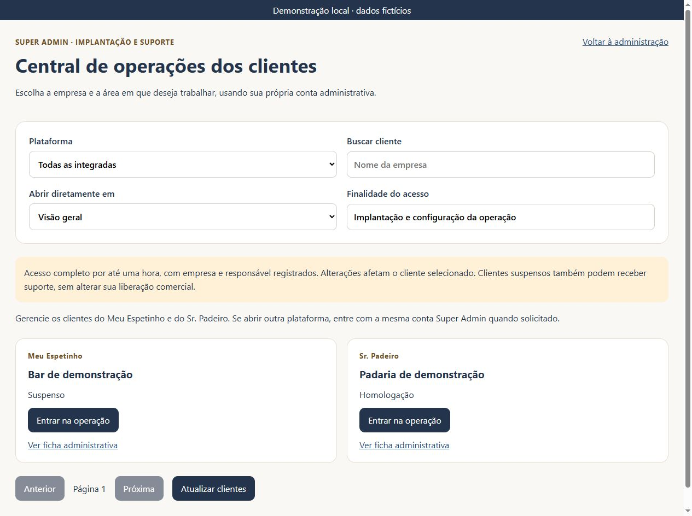
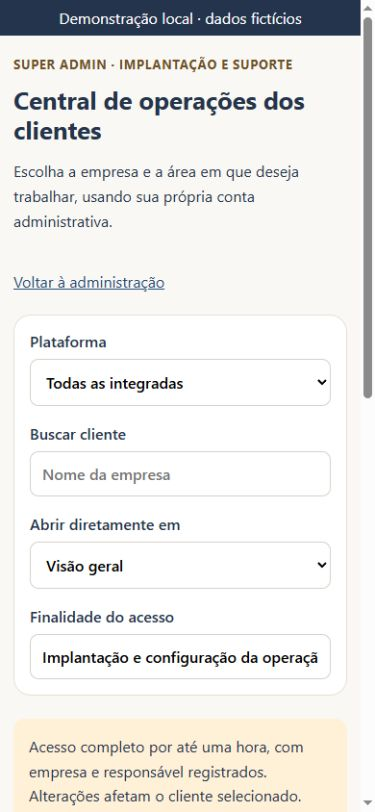

# Central de operações — Meu Espetinho e Sr. Padeiro

Entrega de 11/11/2026. Escopo confirmado pelo usuário: os dois aplicativos.

## Uso

Abra `/admin/operacoes` em qualquer um dos dois aplicativos com sua conta Super Admin. A central reúne os clientes dos dois produtos, com busca por nome, filtro de plataforma e paginação (até 30 empresas de cada plataforma por página). Escolha a área e clique em **Entrar na operação**. A finalidade já vem preenchida e pode ser detalhada antes da entrada.

Atalhos: visão geral, produtos/importação, estoque, compras, marca/recibo/impressora, usuários e atendimento. No Meu Espetinho o estoque abre a edição de produtos e compras abre a lista de planejamento existente; no Sr. Padeiro abrem os módulos próprios. Esta entrega facilita o acesso, sem criar um novo módulo de recebimento de compras no Meu Espetinho.

Nas fichas dos clientes, o acesso completo passa a ter nome explícito e seleção da área inicial. O Sr. Padeiro também permite iniciar suporte a partir da consulta administrativa da operação. Os painéis exibem a entrada da central. A ficha do Meu Espetinho passa a aceitar o cliente indicado no endereço.

Durante o suporte, a faixa informa o nome da empresa, oferece atalhos por área, troca de cliente/plataforma, renovação e encerramento. A sessão dura até uma hora, usa a própria identidade do Super Admin e mantém os registros existentes de auditoria. Em outra origem, pode ser necessário autenticar a mesma conta no aplicativo de destino. Não há compartilhamento ou transferência de tokens pela URL.

## Permissões e integridade

- A central valida a conta com `auth.getUser` e exige cadastro ativo com papel `superadmin` antes de consultar as carteiras. As políticas do banco continuam controlando as leituras.
- A entrada utiliza `ops_start_support`; o destino só é devolvido após resposta válida com prazo futuro. As operações continuam verificando o contexto de suporte no servidor. URLs não concedem papel ou associação a empresas.
- O cliente e a plataforma são explícitos no endereço. Se a sessão expira ou é revogada, a faixa retorna à central na próxima verificação. As escritas continuam sujeitas à autorização no banco.
- O acesso de suporte não altera assinatura, permuta, bloqueio comercial, ambiente ou situação fiscal. Não utiliza a senha do cliente.
- Abrir a operação do Meu Espetinho em suporte deixa de cadastrar automaticamente produtos de exemplo em um catálogo vazio; isso também vale para as recargas de catálogo após importação/edição.
- Nenhuma nova função, tabela, política, credencial ou permissão foi criada no banco. A inspeção remota confirmou as políticas existentes de produtos/categorias/estoque e o bloqueio de senha pendente.

## Verificação

- 40 testes compartilhados aprovados (39 da execução integral mais um teste adicional de catálogo vazio executado na suíte direcionada), incluindo quatro novos testes da central/abertura de catálogo. Cobrem destino e empresa, áreas dos dois apps, falha e expiração do suporte, autorização antes de listar clientes, filtro/paginação e ausência de cadastro automático em suporte.
- TypeScript, build e smoke dos dois aplicativos aprovados; o ajuste final de posição da faixa de suporte é verificado novamente pelo CI da revisão. Permanece o aviso preexistente de tamanho dos pacotes JavaScript.
- Navegador com os componentes reais e API simulada: listar os dois produtos, entrar diretamente em produtos de um cliente suspenso de demonstração, visualizar importador/edição de estoque, abrir marca/recibo/impressora e retornar à central. Nenhuma gravação de cliente real foi executada.
- Celular 390×844: largura disponível e conteúdo de 375 px, sem transbordamento na central e nas configurações. Computador conferido na janela padrão; nenhum erro de console na demonstração.

## Arquivos principais

`packages/operations/src/OperationHub.tsx`, `supportNavigation.ts`, `operation-hub.css`, `SuperAdminOperation.tsx`, `TeamPanel.tsx`; entradas administrativas e de operação dos dois aplicativos; `cloudStore.ts` do Meu Espetinho; `packages/operations/tests/operationHub.test.mjs`.

## Publicação

Publicar a interface dos dois aplicativos na Hostinger. Esta entrega utiliza as funções de suporte e bases já publicadas; não exige nova migração ou alterações de contas. Validar as duas páginas `/admin/operacoes` e reabrir os aplicativos instalados após a atualização. Não há emissão fiscal, cobrança ou venda real como parte desta entrega.
