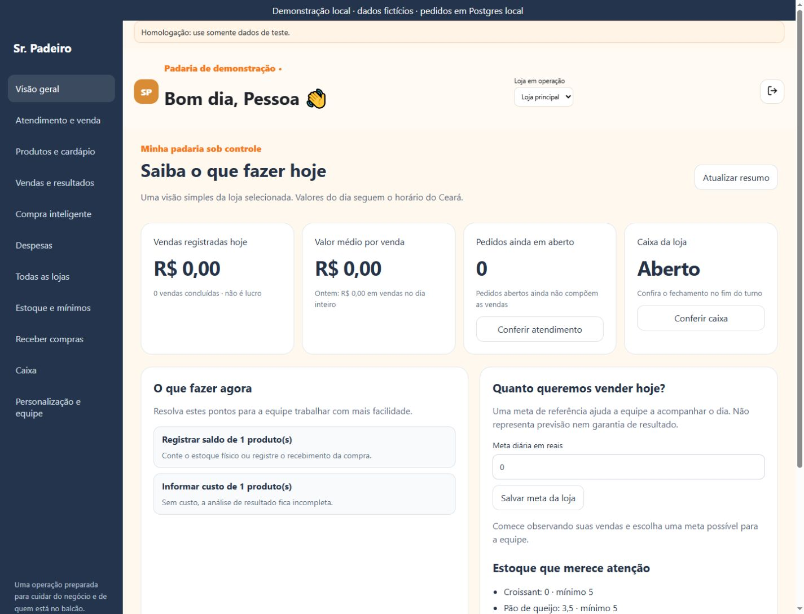

# Sr. Padeiro — atendimento, pedidos e gestão guiada

Entrega de 31/10/2026 na branch `feat/sr-padeiro-gestao-plataforma`, PR #163. Nenhuma alteração foi aplicada em banco ou clientes de produção.

## Resultado para quem usa

O proprietário e o gerente passam a encontrar uma visão diária com tarefas práticas: abrir/conferir caixa, registrar saldos, revisar produtos, informar custos e acompanhar os pedidos. Cada tarefa abre a área correspondente. O painel usa expressões como “valor médio por venda” e explica a diferença entre venda, custo e resultado, sem prometer lucro.

O atendimento foi separado da gestão, com busca por nome, variante ou código de barras, seleção de balcão/retirada/encomenda, quantidade em unidade ou peso, cliente/identificação e horário de retirada. Enter em um código de barras exato adiciona o produto. Preço e custo podem ser corrigidos no cadastro sem importar novamente a planilha; adicionar produtos e importar catálogo ficam em uma área expansível para reduzir a quantidade de formulários na tela.

## Pedidos e recebimento

- Fila compartilhada por empresa e loja, com pedidos em preparo, prontos, concluídos e cancelados. Um pedido salvo pode ser retomado por outra pessoa autorizada.
- Encomenda exige identificação do cliente e horário de retirada. Retirada exige identificação. Balcão permite identificação opcional.
- Salvar não recebe pagamento e não reserva estoque. A disponibilidade é conferida na conclusão; a encomenda aberta não entra no faturamento.
- A fila prioriza pedidos em aberto e inclui registros concluídos/cancelados atualizados no dia. Exibe até 100 registros e informa quando há mais pedidos em aberto que os exibidos. Paginação e busca histórica ampliada permanecem como evolução para operações maiores.
- Marcar pronto não registra uma venda. Cancelar um pedido aberto exige motivo; caixa só cancela pedidos que ele criou, enquanto proprietário/gerente e suporte autorizado podem tratar os demais. Pedidos já vendidos não podem ser cancelados por esse botão.
- O recebimento exige caixa aberto da mesma loja e aceita PIX, dinheiro, débito e crédito. Esses meios são registrados pela equipe; não representam confirmação automática do banco ou da adquirente. Fiado sem cliente identificado foi retirado desse novo fluxo e é recusado no servidor. Os dados históricos de fiado permanecem.
- A conclusão cria venda, itens, pagamento e baixa de estoque na mesma transação. Se faltar saldo, toda a conclusão é desfeita, mantendo o pedido em aberto para correção.
- O recibo mantém a identificação não fiscal e inclui o número curto/tipo do pedido e sua identificação quando houver. O resumo do atendimento pode ser aberto para compartilhamento manual no WhatsApp, sem envio automático. Não houve mensagem enviada nesta execução.

Esta etapa trabalha com pagamento integral e fechamento do pedido. Não implementa sinal, pagamento parcial, reserva de produção ou uma etapa independente de entrega depois do pagamento. Para encomendas futuras, o fluxo proposto é salvar e receber/concluir na retirada; não anunciar controle completo de encomendas pré-pagas antes de desenvolver essa distinção.

## Proteção contra venda duplicada

Cada atendimento tem UUID próprio, mantido no rascunho e usado na fila do banco. Uma confirmação bem-sucedida é reutilizada nas repetições. Salvar repetidamente a mesma tentativa também reutiliza o registro; uma revisão diferente precisa apresentar a versão atual do pedido.

A tentativa é preservada no armazenamento do navegador, por empresa, loja e usuário, antes da chamada de confirmação. Enquanto o resultado estiver incerto, os dados ficam bloqueados para edição e a interface oferece consulta/retentativa ou conferência no servidor. Recarregar não cria outra identidade de venda. Armazenamento local indisponível impede iniciar uma confirmação que não possa ser preservada. Pedidos já salvos continuam no banco; apagar o armazenamento do navegador pode perder rascunhos ainda não salvos e a identificação de uma tentativa pendente, exigindo conferir a fila antes de começar novamente.

O servidor verifica novamente perfil ativo, situação de acesso, loja, caixa, produtos, quantidades, versão e preços. Mudança de preço ou edição por outra pessoa exige revisão antes de receber. Quantidades UN são inteiras; peso permite até três casas. Os totais são arredondados por item em centavos de forma consistente com a venda e o pagamento.

## Gestão que orienta a ação

| Informação | Comportamento |
|---|---|
| Vendas do dia | Agregadas no banco para a loja selecionada, somente vendas concluídas, no horário do Ceará. |
| Valor médio por venda | Vendas do dia divididas pela quantidade; sem venda, mostra zero. |
| Comparação de referência | Mostra o total de ontem inteiro, sem afirmar crescimento comparável durante um dia ainda em andamento. |
| Pedidos abertos e atrasados | Separados das vendas; horário vencido ajuda a priorizar retiradas. |
| Caixa | Situação da loja e atalho para abrir ou conferir. |
| Meta diária | Referência por loja, persistida até nova alteração, sem garantia de resultado; cálculo de progresso e valor restante. |
| Estoque | Produtos sem saldo e até cinco saldos no mínimo; encaminha para recebimento/contagem. |
| Cadastro | Itens fora de venda e custos ausentes; edição de preço/custo auditada e restrita a perfis de catálogo. |
| Resultados e pessoas | Atalhos para os relatórios de custos/despesas, compras e configuração de equipe já existentes. |

O resumo é gerencial e não substitui conciliação bancária, lucro contábil nem o relatório completo. Produtos e custos pertencem ao catálogo da empresa; saldos, caixa, pedidos, vendas e meta desta tela seguem a loja selecionada. Custos anteriores ausentes continuam aparecendo como pendência no relatório de resultados; informar o custo atual não reescreve vendas históricas.

## Segurança e banco

Nova migração: `supabase/migrations/20261031105941_srp_counter_orders_and_guided_management.sql`.

Pedidos e metas ficam no esquema privado, com RLS habilitada e sem grants diretos aos clientes. O RPC público `srp_counter` usa implementação privada com verificação explícita de autenticação, senha obrigatória, acesso, perfil e empresa. A sessão de suporte do Super Admin precisa estar válida para atuar na operação. Leituras de acompanhamento do Super Admin não conferem poder de venda sem o contexto autorizado.

A migração bloqueia o endpoint antigo de venda, que não tinha identidade de tentativa, e retira escrita direta e privilégios de tabela desnecessários nas tabelas de venda, itens e pagamentos dos papéis de cliente. A função anterior fica privada e sem execução para cliente; o novo fluxo não a utiliza. A gravação da venda é feita exclusivamente pelo novo caminho de confirmação para os clientes comuns. As leituras existentes continuam sujeitas às suas políticas RLS. Registros de servidor com privilégios próprios não devem ser usados como API pública de venda.

Metas, edições, pedidos, transições e conclusões registram o ator em `srp_operation_events`. A mudança não habilita integração fiscal real nem modifica métodos de cobrança da assinatura da plataforma.

## Verificação

**70 testes aprovados:** 36 compartilhados (incluindo nove novos de pedidos/rascunho/integração), 31 administrativos/Edge/gestão do Sr. Padeiro e três fiscais/recibo do Meu Espetinho. Os novos testes executam a migração real em Postgres local/PGlite e verificam:

- salvar/retomar, pronto, conclusão e repetição sem outra venda, pagamento ou baixa;
- rollback por estoque insuficiente, caixa ausente e preço alterado;
- fiado recusado, identidade/horário exigidos, quantidades e arredondamento em KG;
- versão concorrente e cancelamento com motivo/perfil;
- isolamento de loja/produto/empresa, senha obrigatória, anônimo e suporte expirado;
- fechamento antigo recusado e escrita direta bloqueada;
- totais de gestão separados dos pedidos, permissão de meta e edição de preço/custo;
- persistência de rascunho/tentativa separada por empresa, loja e usuário.

A integração com a gestão mais recente da versão principal preserva estoque/mínimos, compra inteligente, despesas e resultados por loja. O recebimento e o relatório consolidado permanecem disponíveis em `PlatformManagement.tsx`, com estilos isolados. A edição e o recebimento com atualização de custo marcam sua revisão; custo zero confirmado é distinto de custo desconhecido. Um teste integrado executa a gestão e o atendimento juntos e verifica custo histórico, receita e saldo. A consulta do superadministrador mantém os controles de alteração desabilitados; a operação completa exige sessão de suporte autorizada.

TypeScript, build e smoke do Sr. Padeiro aprovados. Permanece o aviso de tamanho do pacote JavaScript, já existente; esta entrega não representa teste de carga ou certificação de capacidade.

No navegador, foram usados os componentes reais, autenticação/dados de catálogo de demonstração e RPC de pedidos/gestão conectado ao Postgres local com a migração desta entrega. Foram conferidos: rascunho após recarregar; salvar e retomar da fila; pronto; recebimento, recibo e redução de estoque; edição de custo resolvendo a tarefa gerencial; meta; encomenda com data/hora; celular 390×844, tablet 834×1112 e computador 1440×1100, sem transbordamento horizontal nas larguras medidas. Perfis de apresentação são simulados; a autorização foi testada no banco local.

Uma resposta de conclusão foi descartada propositalmente pelo adaptador de teste após o commit local: ao recarregar e consultar a tentativa preservada, o aplicativo recuperou a venda existente e seu recibo. A fila continuou com apenas as duas vendas legítimas do roteiro e estoque correspondente, sem uma terceira venda pela retentativa. Nenhuma cobrança, mensagem, impressão física ou escrita em produção foi executada.

## Arquivos

`src/PlatformManagement.tsx`, `src/platform-management.css`, `src/Counter.tsx`, `src/GuidedManagement.tsx`, `src/counter.css`, `src/lib/counter.ts`, integração em `src/Workspace.tsx`, nova migração e testes em `packages/operations/tests/srp-counter.test.mjs`, `counterDraft.test.mjs` e `fixtures/srp-counter.mjs`.

## Publicação coordenada — pendente de aprovação

1. Revisar a alteração, as dependências de operações/contas e a migração anterior de gestão/custo histórico. Planejar uma janela sem vendas e fazer backup verificável.
2. Publicar a migração e a nova interface de forma coordenada. **Clientes antigos deixam de vender pelo RPC anterior**, pois ele retorna `counter_update_required`. Não aplicar apenas o banco e deixar a interface anterior em uso.
3. Atualizar/reabrir os aplicativos instalados e conferir a versão servida na hospedagem atual. Validar proprietário, gerente, caixa e suporte nos aparelhos reais.
4. Homologar caixa, saldo, pedido, resposta perdida e recibo com dados de teste próprios; depois acompanhar o primeiro turno autorizado. Para reversão, preservar os pedidos e seus vínculos de venda e preparar explicitamente a compatibilidade do checkout anterior, sem liberar novamente o risco de duplicidade.

A publicação continua pendente de aprovação. Não houve liberação comercial nem homologação fiscal de clientes reais nesta execução.
