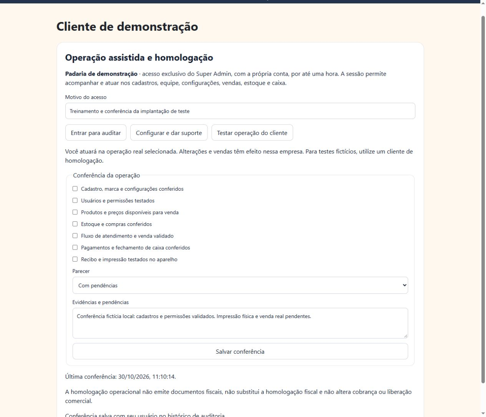

# Super Admin — suporte e homologação operacional

Entrega de 30/10/2026 na branch `feat/sr-padeiro-gestao-plataforma`, PR #163.

## Caminho nos dois aplicativos

Administração → Clientes → selecionar cliente → **Operação assistida e homologação**.

- **Entrar para auditar** abre a visão geral da operação, sem assumir a identidade do proprietário.
- **Configurar e dar suporte** abre as configurações, com acesso aos demais módulos conforme os poderes existentes do Super Admin.
- **Testar operação do cliente** abre a operação para conferência e treinamento.
- Todas as entradas exigem motivo e usam `ops_start_support`, com sessão de até uma hora e verificação no banco. Os três acessos permitem atuação; auditoria não é um modo somente leitura. A interface avisa que alterações e vendas têm efeito na empresa selecionada.
- O modo de suporte fica identificado, permite circular por cadastros, usuários, produtos, compras, estoque, atendimento, resultados e caixa, e oferece encerramento para voltar à central. O Super Admin não recebe vínculo permanente na equipe do cliente e não precisa da senha dele.

## Conferência de implantação

Checklist: identidade/configurações, equipe/permissões, catálogo/preços, estoque/compras, atendimento/venda, pagamentos/caixa e recibo/impressora. Parecer: em conferência, com pendências ou homologado. Aprovação exige os sete itens e observações com evidências. O banco registra autor, data, empresa e parecer, conservando cada alteração em `operation_audit`.

A conferência não altera cobrança, liberação comercial ou dados fiscais e não promove automaticamente um cliente a produção. Não é certificação fiscal. Nenhum cliente real foi homologado nesta execução.

## Correções de contexto

Meu Espetinho recusa suporte quando a empresa não estiver disponível ao administrador ou a sessão não for válida, em vez de selecionar outra empresa. O suporte também aguarda dados atuais da empresa e não trabalha com o cache local se a sincronização falhar. Sr. Padeiro recusa o parâmetro de suporte para contas sem o perfil Super Admin e recusa conflito com a empresa nomeada no endereço. O atalho de configuração abre efetivamente a área de personalização no Sr. Padeiro.

## Arquivos

Compartilhados: `SuperAdminOperation.tsx`, `operations.css`, exportação e teste `operationReview.test.mjs`. Banco: `20261030140605_superadmin_operation_review.sql` em Meu Espetinho (migração compartilhada, aplicar uma única vez). Integração: fichas administrativas dos dois aplicativos, seus controles de entrada e o componente de operação do Meu Espetinho e do Sr. Padeiro.

## Validação

27 testes compartilhados aprovados, incluindo execução da migração em Postgres local via PGlite: conta comum, administrador inativo e anônimo recusados; senha obrigatória respeitada; empresa errada recusada; checklist incompleto e tipos inválidos recusados; aprovação válida e reabertura com pendências preservadas no histórico; isolamento entre produtos. A suíte já verifica início, encerramento e expiração das sessões de suporte.

TypeScript, compilação e smoke tests dos dois aplicativos aprovados. Avisos de tamanho de pacote JavaScript permanecem.

Navegador local, API simulada e dados fictícios: salvar pendências, abrir a operação real do componente Sr. Padeiro em suporte, exibir identificação da sessão, navegar ao resumo e encerrar para voltar à administração. Painel conferido no computador e em largura de celular, sem transbordamento horizontal. A captura abaixo é uma demonstração local; não comprova liberação de produção nem testes em equipamento físico.

## Publicação pendente

Nenhuma migração foi aplicada em produção. Para disponibilizar: revisar/aprovar o PR, aplicar a migração compartilhada após as bases de operações e contas, publicar os dois aplicativos na hospedagem atual e testar com a conta Super Admin autorizada. Homologação dos clientes reais ainda exige conferir seus cadastros, perfis, saldos, impressora e fluxo de venda; testes fictícios devem usar cliente de homologação, sem contaminar vendas reais.
